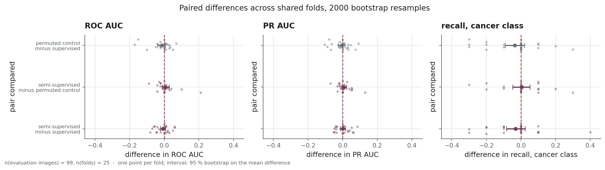
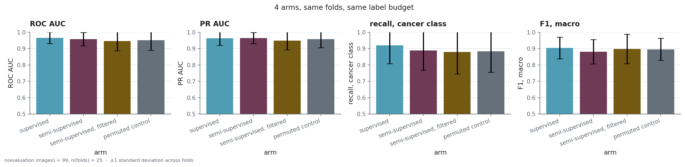
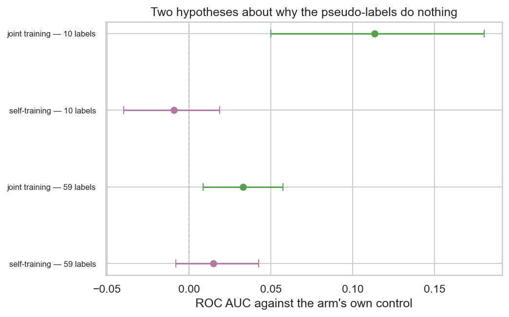
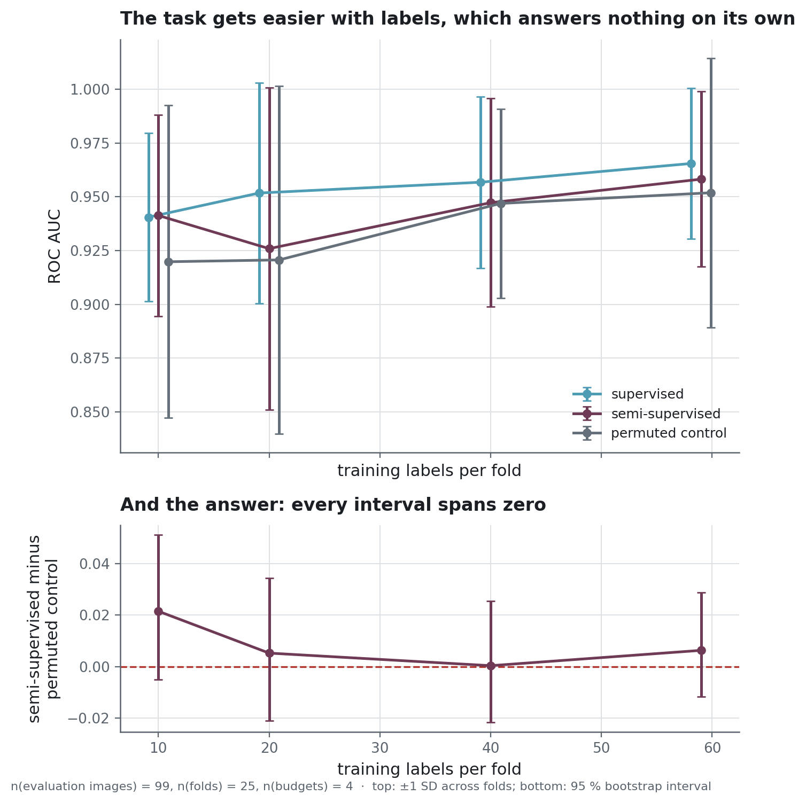
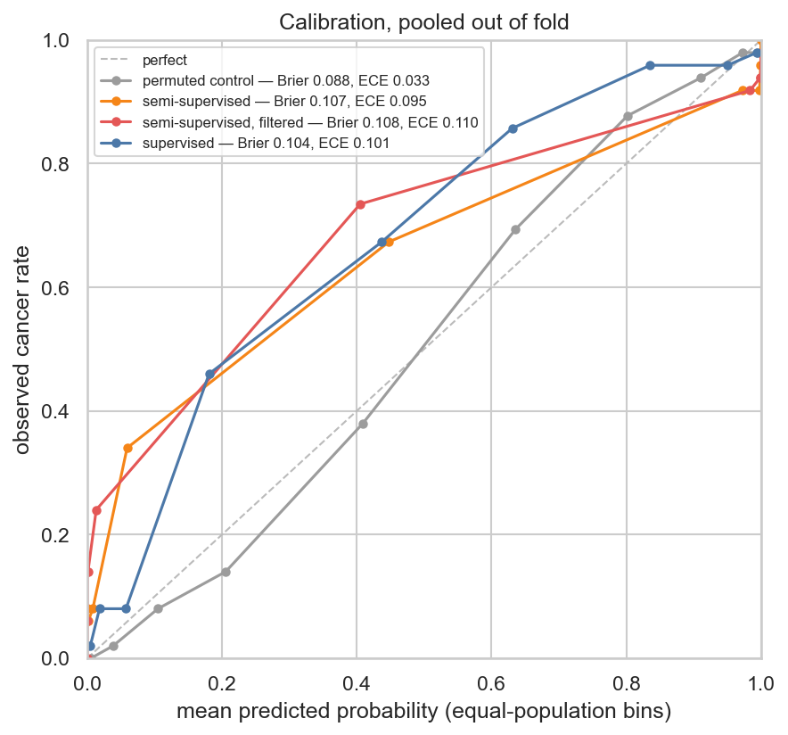
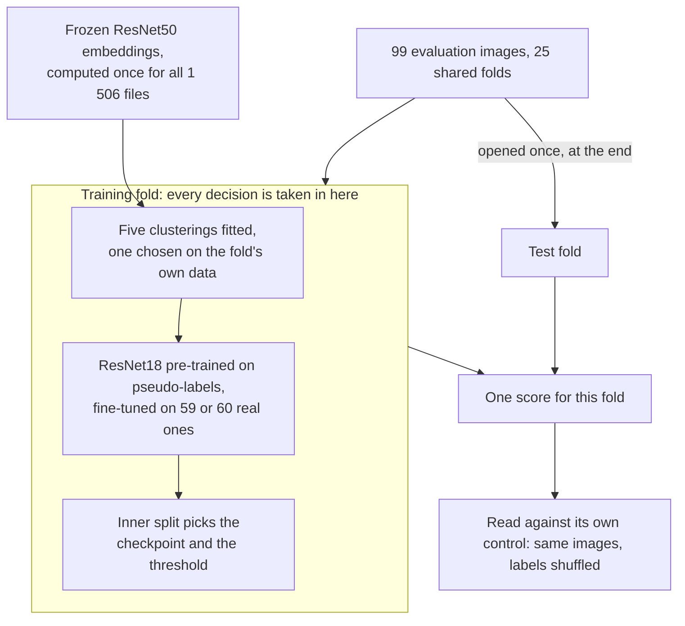

<h1 align="center">Semi-supervised MRI</h1>

<p align="center">A leak-free test of semi-supervised learning on 100 labelled brain MRI slices</p>

<p align="center">
  
  
  
  
</p>

<div align="justify">

**Project status** — finished. The experiments are complete and their outputs are committed
under `reports/experiments/`. The eight arms ran over 25 folds in two runs that took 74 and 30
minutes on one RTX 4060 Ti. The headline table names the run behind each row, and each run
folder records the dataset fingerprint, the seeds, the package versions and the git revision
it was produced with. Reproducing a run requires the image archive, which this repository has
no right to redistribute.

**No diagnostic use is intended or supported.** The arms answer a methodological question on
an archive of research images, and no number published here should inform a clinical
decision.

## The problem

Labelling a brain MRI requires a radiologist, while unlabelled scans cost little to collect. A
common question in medical imaging is therefore whether unlabelled scans can improve a
classifier trained on few labels. One method clusters the unlabelled pool, turns the clusters
into pseudo-labels, pre-trains a network on those pseudo-labels and fine-tunes it on the real
labels.

Three defects in the experiment can each produce a positive answer for a method that has no
effect. The pseudo-labels can be built with the help of the test labels. The evaluation images
can also appear in the unlabelled pool. Finally, the semi-supervised arm can take more gradient
steps than the arm it is compared with, in which case the comparison measures the extra
training. Each of these defects looks like an ordinary line of code.

This repository builds a protocol that excludes all three, so that a negative answer from it
can be trusted. Several of its comparisons come out significant, so the protocol is able to
detect a difference.

## What it does

Eight arms share their folds and their architecture. All of them start from the same ImageNet
weights, and the new two-class output layer is initialised from a seed derived for each arm. The
evaluation uses 25 folds, five stratified splits repeated five times, over 99 distinct
evaluation images. Each fold trains on 59 labels, or 60 in five of the 25 folds, and the result
files call this full budget "59 labels". Three of the arms are controls. Each control sees the
same unlabelled images as one treatment arm with the pseudo-labels shuffled, and that treatment
is read against it. The confidence-filtered arm drops the pseudo-labels below a confidence
quantile that the inner validation split selects. The selected quantile is 0, so nothing is
dropped, in 9 of the 25 folds. It is read against the control of the plain semi-supervised arm,
which pre-trains on the full pool for the same number of steps.

[`docs/protocol.md`](docs/protocol.md) describes the five design rules, the arms and their
controls, and the nine tests of `tests/integration/test_no_leakage.py`.

### How it is built

Each image is embedded once by a frozen **ResNet50** from **torchvision**, and the embeddings
are cached as **Parquet**. The cache records the backbone and the preprocessing it was built
with, and `scripts/build_features.py` will not reuse a cache whose backbone, preprocessing or
list of images differs from the request. The experiment selects the plain or the equalised file
by its name. Inside each training fold, **scikit-learn** fits five clusterings (KMeans,
agglomerative clustering with ward and with average linkage, GMM and DBSCAN), and the fold keeps
the one that agrees best with its own training labels. Agglomerative clustering with ward
linkage is kept in 24 folds out of 25. The kept clustering becomes pseudo-labels, a **PyTorch**
ResNet18 pre-trains on them, and the network is then fine-tuned on the fold's real labels. The
checkpoint and the decision threshold are chosen on an inner validation split. Intervals on the
pooled score of one arm are bootstrapped over images, and intervals on a difference between two
arms are bootstrapped over the 25 paired folds. The package also implements a Holm correction,
and the p-values published on this page are uncorrected.

**uv** locks the environment and takes PyTorch from the CUDA 12.6 index on Windows and from the
CPU index on other platforms. **Ruff** and **Bandit** run in the pre-commit hooks and in a CI
workflow that is started by hand. **pytest** runs three tiers of tests, and the system tier
trains a real ResNet18 end to end on a synthetic dataset of 24 labelled and 20 unlabelled
images.

## The result

<!-- source: reports/experiments/arms.csv -->
| arm | what it adds | mean fold ROC AUC | SD across folds | n | run |
|---|---|---|---|---|---|
| `supervised` | nothing: the reference | **0.966** | 0.035 | 99 | `corrected` |
| `self_training` | pseudo-labels from its own first pass | 0.963 | 0.036 | 99 | `corrected-stageb` |
| `semi_supervised` | pseudo-labels from the fold's clustering | 0.958 | 0.041 | 99 | `corrected` |
| `semi_supervised_joint` | the same labels, present at every step | 0.955 | 0.041 | 99 | `corrected-stageb` |
| `permuted_control` | the same images, labels shuffled | 0.952 | 0.063 | 99 | `corrected` |
| `self_training_control` | self-training's images, labels shuffled | 0.948 | 0.069 | 99 | `corrected-stageb` |
| `semi_supervised_confident` | the clustering pseudo-labels, filtered by a confidence quantile set per fold | 0.945 | 0.058 | 99 | `corrected` |
| `joint_permuted_control` | joint training on shuffled labels | 0.922 | 0.063 | 99 | `corrected-stageb` |

> **How to read it.** One row per arm, an arm being one way of using the unlabelled scans.
> `mean fold ROC AUC` averages the 25 folds, and each fold is scored on the images it held out.
> ROC AUC (area under the receiver operating characteristic curve) is the probability that the
> model ranks a cancer scan above a normal one. `SD across folds` is the standard deviation of
> those 25 values, and it shows how much the result changes from one split to another.
Each row is the mean of 25 fold values at the full label budget, with their standard deviation
beside it. [`metrics.yaml`](metrics.yaml) defines the two metric columns.

On mean fold ROC AUC, every arm that uses the unlabelled pool scores below the supervised
baseline. In the corrected run, every paired interval on ROC AUC and on recall contains zero.
No arm is significantly above the supervised baseline at any label budget or under histogram
equalisation. At 10 labels the semi-supervised arm ties with the baseline at 0.941, and under
histogram equalisation two arms fall significantly below it, with intervals that exclude zero.

<!-- source: reports/figures/MANIFEST.json -->


> **How to read it.** Each of the three panels shows one metric, and each row compares two
> arms. A dot is one of the 25 shared folds, and the interval is a 95 % bootstrap on their
> mean. When an interval crosses the vertical zero line, the two arms of that row cannot be told
> apart on this dataset. The comparison is made fold by fold, so differences between splits
> cancel out.

<!-- source: reports/figures/MANIFEST.json -->


> **How to read it.** The four arms of the corrected run, on four metrics. PR AUC (area under
> the precision-recall curve) measures how many of the scans flagged as cancer are cancer,
> across all thresholds. Macro F1 gives the two classes equal weight at the chosen threshold.
> Each panel draws one point per fold, a line at the mean and a bar of one standard error. On
> all four panels the folds of the different arms overlap almost completely.

The pooled out-of-fold ROC curves are in
[`docs/protocol.md`](docs/protocol.md#two-quantities-called-roc-auc). The table above averages
the ROC AUC of each fold, while the curves pool every out-of-fold score into one ranking and so
mix folds whose scores are calibrated differently. For the four arms of the corrected run, the
pooled value is lower than the fold average by up to 0.021.

### What the pseudo-labels carry

<!-- source: reports/figures/MANIFEST.json -->


> **How to read it.** Two hypotheses about the pseudo-labels, each tested at two label budgets.
> Each row compares an arm with its own control, which saw the same images with the labels
> shuffled. Both see the same extra images, so a difference between them comes from the labels.
> Dots are folds and the interval is a 95 % bootstrap. A row supports a mechanism only when its
> interval excludes zero.

<!-- source: reports/experiments/mechanisms.csv -->
Joint training scores above its own control by **+0.033 [+0.009, +0.057], p = 0.008** at the
full budget of 59 labels, over n = 99 evaluation images.

<!-- source: reports/experiments/mechanisms.csv -->
At 10 labels the same comparison gives **+0.113 [+0.050, +0.180], p = 0.002**, over the same
n = 99 images. The clustering pseudo-labels therefore carry structure that shuffling destroys.
Self-training shows no such effect, and both of its intervals contain zero.

Against the supervised baseline the joint arm is still behind, by 0.010 at 59 labels and by
0.016 at 10 labels, and neither gap is significant (p = 0.11 and 0.27). These two p-values were
computed for this page with `uncertainty.paired_difference`, pairing the supervised and joint
runs fold by fold, and no results file publishes this comparison. The pseudo-labels carry
information, and the arm that trains on them still scores below the baseline.

<!-- source: reports/experiments/budget-10-stageb/summary.md -->
**The `p = 0.002` at ten labels comes from a weak control.** At ten training labels, over the
same n = 99 evaluation images, the joint control reaches 0.811, and the joint arm leads it by
+0.113.

The same control reaches 0.922 at 59 labels, and the supervised arm reaches 0.941 at ten labels.
Training on shuffled pseudo-labels at every step therefore does much more harm than leaving the
unlabelled pool out. The +0.113 gap comes from the control falling 0.129 below the supervised
arm, while the joint arm itself sits 0.016 below it. The joint arm leads its control and trails
the baseline, and this page reports both comparisons.

### Results at four label budgets

<!-- source: reports/figures/MANIFEST.json -->


> **How to read it.** The upper panel plots the mean fold ROC AUC of three arms against the
> number of training labels. The supervised arm and the control rise with the budget, and the
> semi-supervised arm dips at 20 labels before rising again. The lower panel plots the
> semi-supervised arm minus its own control at each budget, with a 95 % bootstrap interval.
> Each of those intervals contains zero, so the pseudo-labels show no measurable gain at any of
> the four budgets.

<!-- source: reports/experiments/label_efficiency.csv -->
| budget | mean fold ROC AUC | semi minus control | paired p | n |
|---|---|---|---|---|
| 10 labels | 0.941 | +0.022 [−0.005, +0.051] | 0.12 | 99 |
| 20 labels | 0.926 | +0.005 [−0.021, +0.034] | 0.71 | 99 |
| 40 labels | 0.947 | +0.000 [−0.022, +0.025] | 0.97 | 99 |
| 59 labels | 0.958 | +0.006 [−0.012, +0.029] | 0.57 | 99 |

> **How to read it.** One row per label budget. The second column is the mean of the
> semi-supervised arm across folds. The third is its paired difference from its own control,
> with a 95 % interval, and `paired p` is the bootstrap p-value of that difference. An interval
> that contains zero and a p above 0.05 express the same result.
The supervised baseline reads 0.941, 0.952, 0.957 and 0.966 at the same four budgets. Intervals
are 95 % bootstrap on the paired difference, over 25 folds.

No difference is significant at any budget, so a Holm correction over the four budgets would
leave the conclusion as it is. The largest difference is at the smallest budget, as the
semi-supervised literature predicts, and its interval also contains zero.

### Contrast and saturation

<!-- source: reports/experiments/equalized/summary.md -->
**The clustering was separating images by contrast.** Running the whole protocol again with
histogram equalisation applied first raises the supervised baseline to 0.979 ± 0.028 over
n = 99 evaluation images.

<!-- source: reports/experiments/equalized/summary.md -->
Paired over the 25 folds the two runs share, the gain is **+0.013 [+0.003, +0.024], p = 0.006**
over n = 99 images. It is the only improvement over the plain supervised baseline in this
repository that reaches conventional significance. Equalisation also lowers the agreement
between the clustering and the labels, measured by the adjusted Rand index (ARI, 0 for chance
and 1 for identical partitions), from 0.457 ± 0.096 to 0.205 ± 0.179. Histogram equalisation
removes global intensity differences, and most of the structure the clustering had found
disappears with them. On this dataset contrast happens to correlate with the class, and a
radiologist would look at other features. Equalisation is off by default, and
[`docs/architecture.md`](docs/architecture.md) gives the reason.

**The task is also close to saturation.** The supervised baseline reaches 0.966, and 8 of its 25
folds score exactly 1.000. That leaves 0.034 of headroom, against a fold-to-fold standard
deviation of 0.035. The paired ROC AUC intervals of the corrected run are between 0.029 and
0.054 wide, so a gain becomes visible only above roughly half that width, 0.015 to 0.027, out of
the 0.034 that remains. An ImageNet-pretrained ResNet18 fine-tuned on 59 images is therefore
already within 0.034 of a perfect score, and that margin leaves little room for the unlabelled
pool to help. Along the label-efficiency curve the gains of the supervised arm are irregular,
at 0.11 of ROC AUC per hundred labels between 10 and 20 labels, 0.03 per hundred between 20 and
40, and 0.05 per hundred between 40 and 59. The size of the remaining margin is the result most
likely to apply to other datasets, because it shows how close a supervised baseline already is
to its ceiling before the semi-supervised question arises.

### What else was measured

<!-- source: reports/figures/MANIFEST.json -->


> **How to read it.** The pooled scores are sorted into ten bins of equal size, and each bin is
> drawn at its mean predicted probability against the share of cancers it contains. Perfect
> calibration lies along the dashed diagonal. The legend gives two summaries per arm. The Brier
> score is the mean squared gap between probability and outcome, and it penalises confident
> errors most. The calibration error is the mean vertical distance from the diagonal.

**Three of the four arms are badly calibrated.** Pooled out of fold, the expected calibration
error is 0.095 to 0.110 for the supervised, semi-supervised and filtered arms, and 0.033 for the
permuted control. The supervised arm has a Brier score of 0.104 and an expected calibration
error of 0.101, with a mean predicted score of 0.407 against a base rate of 0.505. At a
predicted 0.18 the observed cancer rate is 0.46, at 0.44 it is 0.67, and at 0.63 it is 0.86.
Mid-range scores understate the risk by twenty points or more. The scores are published as the
network returns them. A calibrator fitted on the 20 validation images of each fold would mostly
fit noise, and the size of the gap is itself the result.

**The errors concentrate on the duplicated images.** For the supervised arm, which never sees
the pool, the 31 evaluation images that also sit in the unlabelled pool are misclassified 0.155
of the time, against 0.068 for the other 68. The three other arms of the corrected run show a
gap in the same direction, of 0.07 to 0.13. Pre-training cannot explain it for the supervised
arm, so the images filed twice in the archive are harder to classify than the rest.

**The recall target set on validation does not hold on the test folds.** A threshold chosen to
keep 90 % recall on the ten cancer images of the inner validation split reaches a mean recall
of 82.0 % on the test folds, and falls below 90 % in 51 of the 100 fold-and-arm pairs of the
corrected run. That threshold is higher than the F1 threshold in 95 of the 100 pairs, and it
gives up 7 points of recall for 2 points of precision. On this dataset the F1 threshold is
therefore the more sensitive of the two, and a screening use would need the reverse. Both
thresholds and the recall each one achieved are stored fold by fold in
`reports/experiments/corrected/per_fold.parquet`.

## Why these numbers can be believed

The result rests on four properties, and tests check each one. An image is identified by its
pixels, whatever its path. Every decision is taken inside the training fold. The plain
semi-supervised, joint and self-training arms each have a control that sees the same unlabelled
images with shuffled labels. The checkpoint and the threshold are chosen on an inner split that
is disjoint from the test fold. [`docs/protocol.md`](docs/protocol.md) describes these
properties and the nine integration tests, including the one that requires the legacy protocol
to leak.



<!-- source: reports/figures/MANIFEST.json -->


> **How to read it.** Two panels, one metric each, and one row per arm. Each row is the leaking
> run minus the corrected one, fold by fold, so a dot to the right of zero marks a fold where
> the leaking run scored higher. The interval is a 95 % bootstrap on the mean difference. Both runs
> use the same splitting seeds, and folds are paired by repeat and split index. The leaking run
> splits 100 labelled files and the corrected run 99 distinct images, so paired test folds share
> between 12 and 20 of their images.

An earlier version of this pipeline reported a positive result, and four problems lay behind
it. A third of the evaluation set sat in the pre-training pool. The clustering method and the
cluster-to-class alignment were chosen over all 100 labels, outside the folds. The
semi-supervised arm took more gradient steps than its baseline. The reported gain was also a
threshold move. The first two problems are the three leaks. `reports/experiments/legacy/`
reproduces them with the same fold seeds as the corrected run, and the difference between the
two runs measures their price.
[`docs/protocol.md`](docs/protocol.md#what-the-earlier-version-got-wrong) describes all four.

The errors concentrate on the duplicated images, so the first leak placed the hardest
evaluation images in the pre-training pool.

## Running it

```powershell
uv sync --extra dev
$env:MRI_DATA_DIR = "C:\path\to\data"      # the folder that holds raw/; defaults to ./data

uv run python scripts/check_data.py        # is this the same dataset?
uv run python scripts/build_manifest.py    # content identity, duplicates, fingerprint
uv run python scripts/build_features.py    # ResNet50 embeddings, cached
uv run python scripts/run_experiment.py    # the corrected protocol, 74 minutes on an RTX 4060 Ti
uv run python scripts/build_figures.py     # every figure above
```

The archive unpacks into `<MRI_DATA_DIR>/raw/mri_dataset_brain_cancer_oc/` with two folders,
`avec_labels/` and `sans_label/`, which must be renamed `labelled/` and `unlabelled/`. The
labelled folder holds a `cancer/` and a `normal/` folder, and `scripts/check_data.py` prints the
layout it expects. `MRI_DATA_DIR` exists because pre-training reads about 1 300 images per
epoch, and reading them from a synchronised drive starves the GPU. The other modes, the budgets
and the mechanism arms are in [`docs/protocol.md`](docs/protocol.md#reproducing-a-run).

`uv run python -m pytest` runs the 183 tests of the three tiers and measures coverage against a
floor of 66 %.

## Structure

```
src/mri_semisupervised/
├── data/         identity from content, inventory, preprocessing
├── features/     frozen ResNet50 embeddings, cached and guarded
├── models/       clustering helpers, the shared classifier
├── protocol/     splits, pseudo-labels, arms, metrics, intervals, orchestration
└── viz/          plotting helpers
scripts/          one entry point per stage, from inventory to figures
notebooks/        five notebooks, generated and executed by two scripts in scripts/
reports/          per-fold metrics, out-of-fold predictions, run manifests, figures
tests/            unit, integration and system tiers
```

[`docs/architecture.md`](docs/architecture.md) explains how the code is split and what was left
out on purpose.

Each of the five notebooks answers one question. `scripts/build_notebooks.py` generates them
and `scripts/run_notebooks.py` executes them, so the stored outputs of a notebook come from a
single execution. The five notebooks cover [the dataset and what hashing it
revealed](notebooks/01_dataset.ipynb), [what the embeddings
hold](notebooks/02_embeddings_and_clustering.ipynb), [the protocol and its
arms](notebooks/03_protocol_and_arms.ipynb), [where a gain could have
shown](notebooks/04_label_efficiency_and_mechanisms.ipynb), and [what a returned probability
is worth](notebooks/05_calibration_errors_and_leaks.ipynb).

## What this does not prove

**That semi-supervised learning cannot help here.** Four variants were tried: pre-training on
clustering pseudo-labels, the same with a confidence filter, joint training and self-training.
Several ran at more than one label budget or under histogram equalisation, and none scored
significantly above the baseline. That is a stronger statement than one variant would support,
and it still concerns pseudo-labels taken from a clustering of ImageNet embeddings or from the
classifier's own predictions. Self-supervised pre-training on the pool itself was not tried,
and it is the approach most likely to make use of 1 300 unlabelled images.

<!-- source: reports/dataset_summary.json -->
**Anything at n = 99 evaluation images.** A test fold holds 19 or 20 images, so one image moves
accuracy by about 0.05 and one cancer image moves recall by 0.10. The intervals above are wide
because the dataset is small, and a better protocol cannot narrow them. The headroom measurement
above puts a number on that limit.

**Generalisation beyond this dataset.** The images come from one source and one modality, as
512 × 512 slices with no patient identifiers, so folds cannot be grouped by patient. This is a
property of the archive, and patient-level grouping is the first point to check before any real
deployment.

## Licence and data

Code under [MIT](LICENSE).

The MRI images are **not** redistributed here. The archive's terms allow academic use and grant
no right of redistribution. The data files under version control are derived from the images
and contain no pixels. They are enough to check the numbers on this page and too little to
reconstruct a single scan. [`docs/data-source.md`](docs/data-source.md) records where the archive
came from, what the inventory finds in it, and what the rights allow.

</div>
