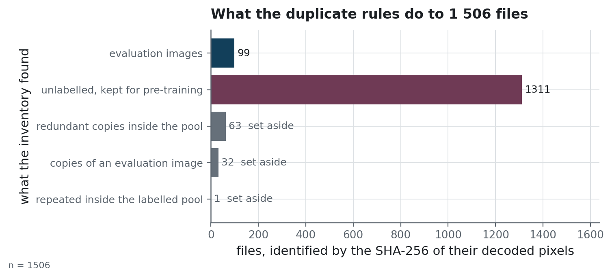
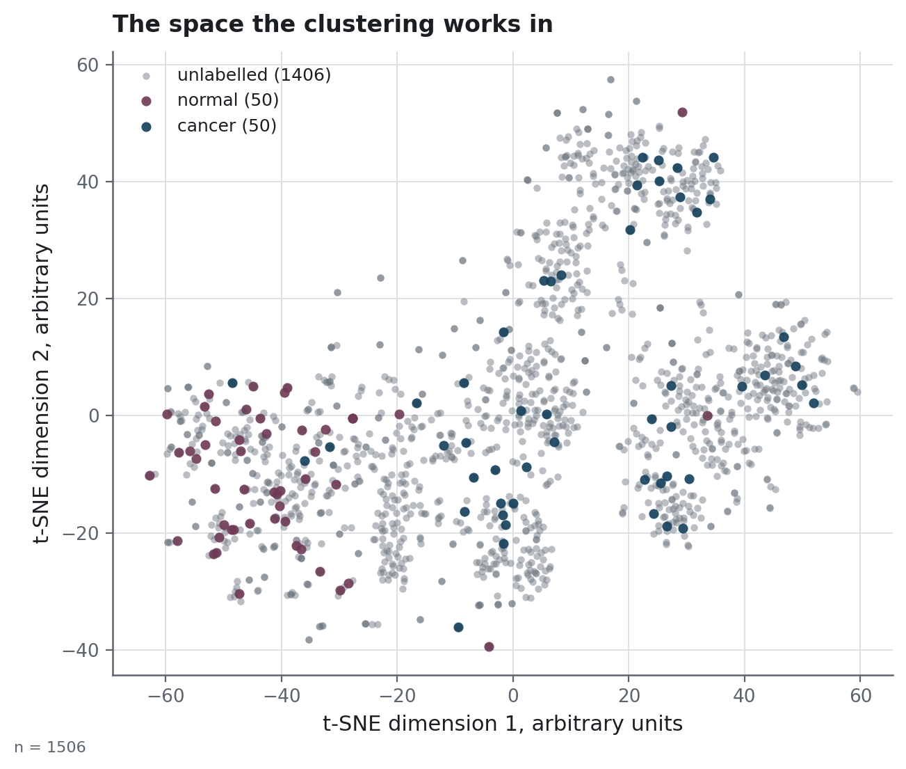

# The image archive: provenance, contents and rights

## The archive

The images come as a fixed archive of brain MRI slices, `mri_dataset_brain_cancer_oc.zip`, of
34.6 MB, received on 2026-05-10 together with a short description of its contents. The archive has no public
download page and no upstream URL. It was handed over with that description, and this page is the only
record of its provenance.

The note shipped inside the archive announces 1 500 images, 1 400 of them unlabelled. The
folders hold 1 506 files, 1 406 of them unlabelled. The archive gives no explanation for the six
extra files, and this repository counts the files as it finds them.

## What is in it

| | |
|---|---|
| Files | 1 506 (100 labelled, 1 406 unlabelled) |
| Format | JPEG, 512 × 512, RGB, one slice per file |
| Labelled classes | `cancer` and `normal`, as two folders |
| Patient identifiers | none: no series, no study, no date |
| Dataset fingerprint | `8f22a69ffa46ca1f` |

The fingerprint is the SHA-256 of the sorted content identities, truncated to sixteen
characters. Every run manifest under `reports/experiments/` carries it, so someone holding the
same archive can confirm that they have the same images.

## What the inventory finds

`scripts/build_manifest.py` identifies every file by the SHA-256 of its **decoded pixels**,
converted to greyscale. Two files that decode to the same pixels therefore share one identity,
whatever their names, folders or file formats. The counts below explain several choices in the
protocol.

<!-- source: ../reports/dataset_summary.json -->
| | |
|---|---|
| Distinct labelled images | 99 (one file is a second copy of another) |
| Class balance of those 99 | 50 cancer, 49 normal |
| Labelled images also sitting in the unlabelled pool | 31, in 32 files |
| Redundant copies inside the unlabelled pool | 63 |
| Unlabelled images left for pre-training | 1 311 |
> n = 1 506 files. `scripts/build_manifest.py` writes these counts to
> [`reports/dataset_summary.json`](../reports/dataset_summary.json), and the table copies them
> from that file.

<!-- source: ../reports/figures/MANIFEST.json -->

> **How to read it.** Every file the archive ships is counted once, in the bar for what the
> inventory decided about it. Bar length is the number of files. The two bars at the top hold
> the files the work uses, and the three below hold the files set aside, each labelled with the
> rule that excluded it. Files are matched on the SHA-256 of their decoded pixels, so a
> duplicate saved again under another name is still recognised.

A labelled image found in the pool leaves the **pool** and stays in the evaluation set.
Dropping it from the evaluation set would amount to choosing the test set after inspecting it.
[`protocol.md`](protocol.md) lists the duplicate rules in full.

<!-- source: ../reports/figures/MANIFEST.json -->

> **How to read it.** Each point is one file, placed by t-SNE (t-distributed stochastic
> neighbour embedding), a method that lays out high-dimensional vectors on a plane so that scans
> the network found similar end up close together. The axes have no units, and large distances
> carry little meaning, so the picture supports statements about local groups. Most normal scans
> sit in one region, most cancer scans lie elsewhere, and the grey pool covers both.

The clustering runs on these embeddings after standardisation and a PCA. The projection shows
the structure of that space with derived coordinates only.

## The pretrained weights

The pipeline has a second input, the ImageNet weights of the two networks, which torchvision
downloads from `https://download.pytorch.org/models/`. `ResNet50_Weights.IMAGENET1K_V2` produces
every embedding the clustering reads, and `ResNet18_Weights.IMAGENET1K_V1` is the starting point
of every arm. The torchvision code is published under the BSD-3-Clause licence
(<https://github.com/pytorch/vision/blob/main/LICENSE>), and its documentation notes that
pre-trained weights may carry their own terms, derived from the data they were trained on. Each
run manifest records the version of `torch` it ran with. The `torchvision` version is absent
from the manifests, and `uv.lock` pins the current one.

These weights are not redistributed here either. They download on first use into the torch
cache.

## Rights

The note inside the archive states its terms in one line, which allows free use for academic
purposes. The note grants no right of redistribution, so this repository keeps the images out
of version control.

**No image is committed to this repository.** The result files under `reports/` hold derived
values only, such as per-fold metadata, per-fold metrics, out-of-fold scores keyed by content
identity, and the run manifests. Anyone reproducing the work supplies their own copy of the
archive and points `MRI_DATA_DIR` at the folder that holds it under `raw/`.
`scripts/check_data.py` then reports whether that copy is the same dataset.

That rule cost one figure. A plate of the twelve most-missed scans, `hardest_images.png`, was
once committed with the plots. It has been purged from the history, and its file name is
listed in `.gitignore`.

## Personal data

The slices carry no identifier of any kind: no patient, no study, no acquisition date, and no
DICOM header. As a consequence, grouping the folds by patient, the first requirement of a
medical dataset, cannot be done here. Two slices of the same person would be treated as two
independent images, because the archive holds no field that links them. This is a limitation of
the data, and it is the first question to ask of any real deployment.
