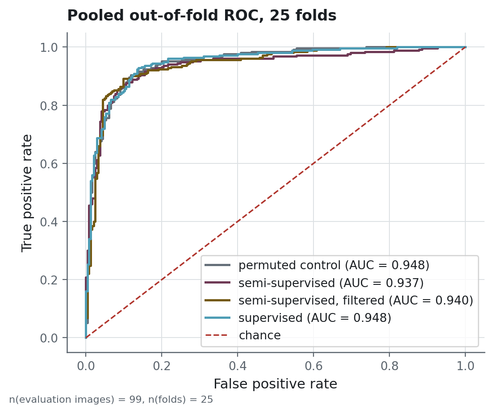

# Evaluation protocol and leakage tests

This repository compares ways of using unlabelled scans, and the comparison is designed so that
a negative result can be trusted. This page sets out the rules the design follows, the eight
arms with the control each one is read against, and the tests that check the protocol for
leaks.

## Design rules

**Images are identified by their content.** Every image is keyed by the SHA-256 of its decoded
greyscale pixels, and its path plays no part in the key. Two copies of one scan in two folders
are therefore one image. The duplicate rules are written down because each of them is a
decision. A pool file whose pixels match an evaluation image is dropped from the pool and kept
in the evaluation set. When the unlabelled pool holds several copies of one image, a single
copy is kept, and the same applies to a repeated evaluation image. When the same content
carries two different labels, the build stops with an error.

**The fold is a boundary.** The clustering, the choice of clustering method and the mapping
from cluster to class are all computed inside the training fold, from the unlabelled pool and
the images of that fold. The test fold is used for none of the decisions, which include the
checkpoint, the threshold and the clustering method.

**Each treatment is read against a control.** The plain semi-supervised arm, the joint arm and
the self-training arm each have a twin that sees exactly the same unlabelled images with the
labels shuffled. Comparing an arm with its control separates the information in the pseudo-labels
from the effect of exposure to the images, and a null result needs that separation to mean
anything. The confidence-filtered arm keeps the pseudo-labels above a confidence quantile chosen
on the inner validation split. The grid of quantiles includes 0, meaning no filtering, and the
published run chose it in 9 of the 25 folds. The arm is read against `permuted_control`, which
uses the whole pool and matches the number of pre-training steps of the filtered arm.

**Model selection uses an inner validation split.** That split is carved out of the training
fold, and it decides the checkpoint, the stopping point and the decision threshold. It holds
20 images at every label budget, so the selection works the same way at every point of the
label-efficiency curve.

**Every comparison comes with its uncertainty.** Comparisons between arms are paired across
shared folds, and their intervals are bootstrapped over the 25 per-fold differences. Intervals
on the pooled out-of-fold score of a single arm are bootstrapped over images. The package
implements a Holm correction for families of comparisons, and the p-values in the published
tables and in the README are uncorrected.

## The eight arms

| arm | what it adds | its control |
|---|---|---|
| `supervised` | nothing: the reference | none |
| `semi_supervised` | pseudo-labels from the fold's clustering | `permuted_control` |
| `semi_supervised_confident` | the pseudo-labels above a confidence quantile chosen on validation | `permuted_control` |
| `semi_supervised_joint` | the same labels, present at every step | `joint_permuted_control` |
| `self_training` | pseudo-labels from its own first pass | `self_training_control` |
| `permuted_control` | the same images, labels shuffled | it is one |
| `joint_permuted_control` | joint training on shuffled labels | it is one |
| `self_training_control` | self-training's images, labels shuffled | it is one |

The joint arm needs a control of its own, and the plain baseline cannot serve as one, because
the joint arm receives a second, unplanned treatment. Its batches of pool images are processed
in training mode, and the BatchNorm layers adjust their running statistics to the pool even
when the pseudo-label loss has a weight of zero. A comparison of that arm with the supervised
baseline would therefore measure two effects at once.

## Two quantities called ROC AUC

The table in the README averages the ROC AUC of each fold. The figure below pools every
out-of-fold score into a single ranking and computes one curve from it. Pooling mixes folds
whose scores sit on slightly different scales. For the four arms of the figure, the pooled
ROC AUC falls 0.003 to 0.021 below the fold average. For the four arms added in the
`corrected-stageb` run the gap reaches 0.060. Each run summary publishes both quantities, and
every comparison between arms uses the per-fold values.

<!-- source: ../reports/figures/MANIFEST.json -->


> **How to read it.** One curve per arm of the corrected run, built from all its out-of-fold
> scores pooled into a single ranking. The horizontal axis is the share of normal scans wrongly
> called cancer, and the vertical axis is the share of cancers detected. Each point on a curve
> is one threshold. A curve that bends further towards the top-left corner separates the
> classes better, and the diagonal shows what random guessing gives. The legend prints the area
> under each curve.

## What the earlier version got wrong

An earlier version of the same pipeline produced a positive answer, and the four paragraphs
below describe what was wrong with it. The first two describe three leaks, since the method and
the alignment were each chosen on test labels. `reports/experiments/legacy/` holds the run of
the `legacy` mode, which the docstring of `experiment.py` describes as reproducing those three
leaks and keeping everything else as in the corrected protocol. The run was produced at
revision `630833a`, which is absent from the published history, so this description comes from
the current code and cannot be checked against the code of that run. It uses the same splitting
seeds as the corrected run, and its folds are paired with the corrected folds by repeat and
split index. Because the legacy run keeps all 100 labelled files in its evaluation set and the
corrected run keeps 99 distinct images, paired test folds share between 12 and 20 of their
images. The budget confound and the threshold move were not re-run.

**A third of the evaluation set was in the training pool.** The image identity was a hash of the
path, so one scan filed twice became two images, and the guard meant to keep labelled images
out of the pool never fired. 31 of the 99 distinct evaluation images were in the pool that the
semi-supervised arm pre-trained on.

**The clustering method was chosen using the test labels**, and so was the cluster-to-class
alignment. Both were decided once, over all 100 labels and outside any fold. Every test fold
therefore helped to pick the method that was later tested on it.

**The comparison confounded method with budget.** The semi-supervised arm took more gradient
steps than the baseline it was compared with.

**The reported gain was a threshold move.** Recall on the positive class rose from 0.900 to
0.960 while the ROC AUC fell from 0.982 to 0.954. A model that ranks the scans better would
raise the ROC AUC as well. The semi-supervised model placed more scans above the fixed 0.5
cut-off while ranking them less well.

The agreement between the clustering and the true labels, measured by the adjusted Rand index
(ARI), reads 0.481 in the legacy run, computed once over the 99 labelled images. Computed inside
each fold over the 79 or 80 labelled images of the training fold, it reads 0.457 ± 0.096. The
legacy clustering is fitted once and reused in every fold, so its spread across folds is zero.
The two values cover different sets of images, and their difference does not isolate the effect
of the leak.

## The tests that assert the absence of leakage

```powershell
uv run python -m pytest tests/integration
```

`tests/integration/test_no_leakage.py` holds nine tests. Seven of them run the corrected
protocol with the training replaced by a recorder of what each arm receives, and they check the
following properties. No test image appears in the pseudo-label set handed to any arm, and no
labelled image either. The copies of evaluation images never appear in that set. The inner
validation and the inner training set never draw from the test fold. Every arm of a fold uses
the same split, and every pre-training arm of a fold is handed the same pseudo-label set. Every
evaluation image is tested once per repeat. What the arms then do with that set is checked by
unit tests in `tests/unit/protocol/test_arms.py`. The permuted control pre-trains on the same
images as the semi-supervised arm. The filtered arm takes the same number of pre-training steps
on a subset of those images.

The eighth test checks the opposite property, and it requires the `legacy` mode to pre-train on
copies of evaluation images. Without it, the other tests could also pass on a protocol
that never had the defect.

The ninth test makes sure that every arm in the registry is either run by default or declared
opt-in. It was written after a fourth arm had been added to the registry and left out of the
configuration. The experiment then ran three arms, and every test passed.

Two unit tests in `tests/unit/protocol/test_pseudo_labels.py` guard the cluster-to-class
alignment in the same way. One flips the labels the mask hides and checks that the alignment
stays the same. The other shows that reading those same labels would have changed the result.
Another unit test, in `tests/unit/protocol/test_arms.py`, records the BatchNorm effect described
above. With the pseudo-label loss weighted at zero, it checks that the joint arm has the same
training loss as the supervised arm and still produces different predictions.

## Reproducing a run

```powershell
uv run python scripts/build_manifest.py    # content identity, duplicate rules, fingerprint
uv run python scripts/build_features.py    # frozen ResNet50 embeddings, cached
uv run python scripts/run_experiment.py    # the corrected protocol, 25 folds
uv run python scripts/run_experiment.py --mode legacy     # price the three leaks
uv run python scripts/build_features.py --equalize        # the equalised embedding cache
uv run python scripts/run_experiment.py --mode equalized  # the preprocessing variant
uv run python scripts/build_figures.py     # every published figure
```

One point of the label-efficiency curve, then the joint and self-training arms with their
controls at the full budget and at 10 labels:

```powershell
$budget = "supervised,semi_supervised,permuted_control"
uv run python scripts/run_experiment.py --label-budget 10 --arms $budget

$stageb = "semi_supervised_joint,joint_permuted_control,self_training,self_training_control"
uv run python scripts/run_experiment.py --arms $stageb --out-name corrected-stageb
uv run python scripts/run_experiment.py --label-budget 10 --arms $stageb --out-name budget-10-stageb
```

Each run writes its own folder under `reports/experiments/`. The folder holds the per-fold
metrics, the raw out-of-fold predictions, the per-fold clustering record, and a manifest naming
the dataset fingerprint, the seeds, the package versions, the GPU and the git revision.
`scripts/run_experiment.py` also writes a summary page from those files, and
`scripts/rebuild_summaries.py` renders it again for every run.
